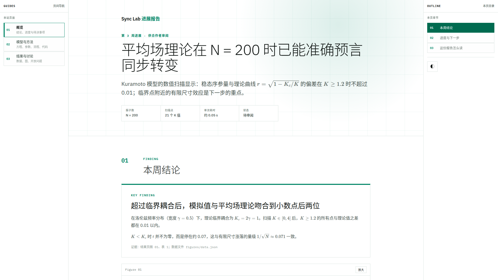
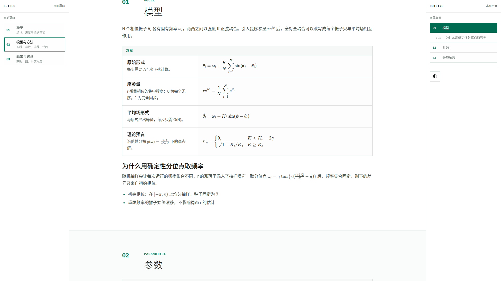
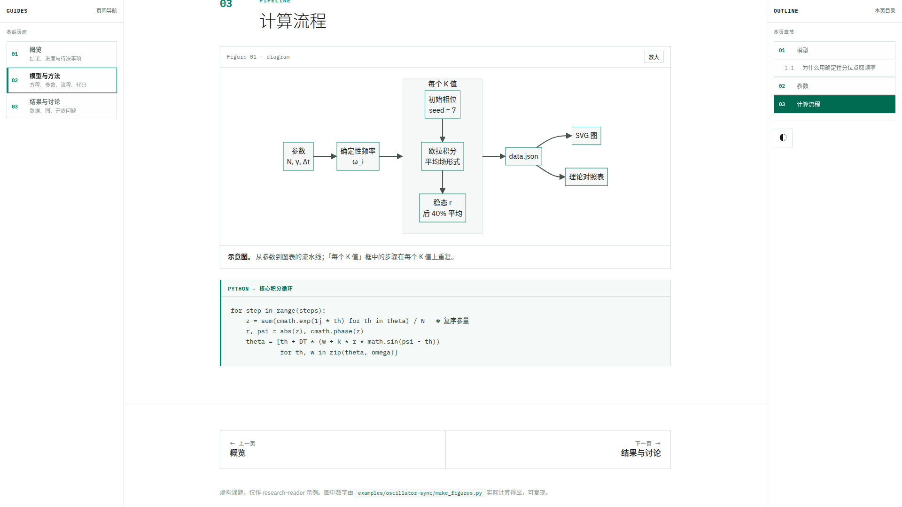
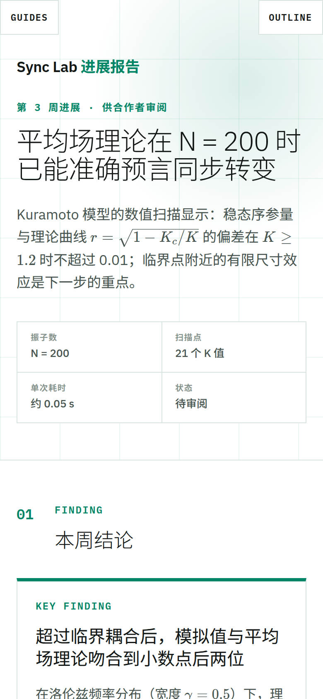
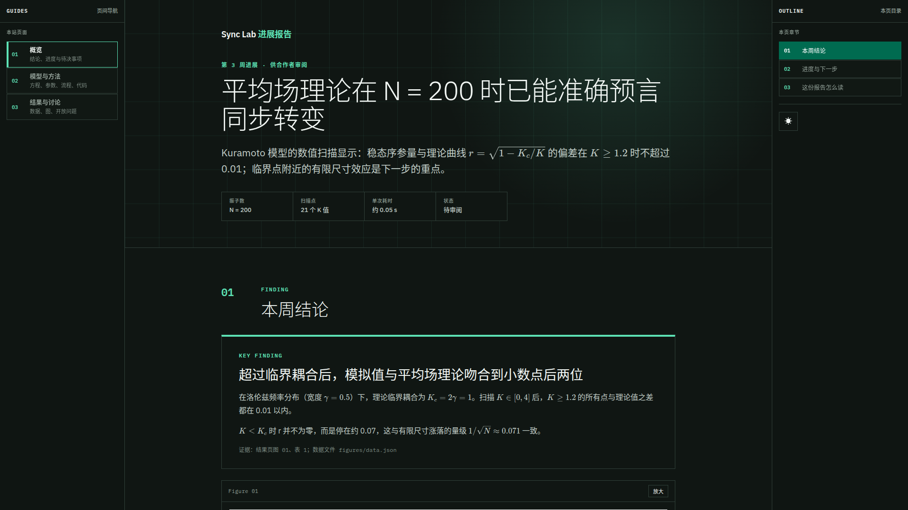
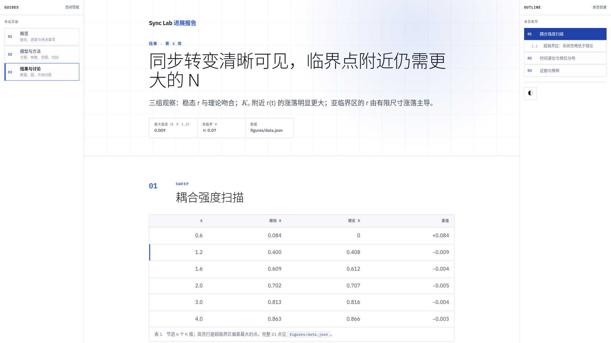

# research-reader

把研究报告、修改说明、给合作者或导师审阅的 AI 产出，做成**适合阅读**的静态网页：左栏页间导航（Guides），右栏本页目录（Outline，自动生成），中间是居中的正文。支持公式、表格、代码、图和 Mermaid 流程图，离线可开。

*A static, offline-capable reading layout for long research material: page navigation on the left, an auto-generated outline on the right, KaTeX math, tables, figures and Mermaid. Write HTML by hand from `template.html`, or let an agent fill a JSON spec and run `render.py`.*



| 公式（KaTeX） | Mermaid 流程图 | 手机 390 宽 |
| --- | --- | --- |
|  |  |  |

| 暗色 | 备选配色 cobalt |
| --- | --- |
|  |  |

## 30 秒上手

只需要 Python 3.9+，不装任何包：

```bash
python3 render.py examples/oscillator-sync/site.json -o examples/oscillator-sync/dist
# 然后双击 examples/oscillator-sync/dist/index.html
```

示例是一个虚构课题“耦合振子同步的数值研究”的 3 页进展报告（概览 / 方法 / 结果）。图里的数字由 `examples/oscillator-sync/make_figures.py` 用纯标准库实际算出来，可复现。

## 何时用，何时不用

| 适合：阅读型 | 不适合：演示型 |
| --- | --- |
| 读者自己按节奏读、反复回看 | 投影到屏幕上边讲边看 |
| 研究进展、方法说明、结果分析、修订前后对比、审阅 AI 的工作 | 分享会、课堂、现场 demo |
| 内容多、层级深，需要导航跳转 | 一页一个要点、以图为主 |

原因：这套版式的设计目标是**提高审阅效率**，信息密度高，两侧导航栏字号小，章节长、公式多。投到屏幕上，这些全都变成“字太小、字太多”。演示请用幻灯片或大字号、图为主的页面。

## 两种用法

### A. 人手写：复制 `template.html`

`template.html` 列出了全部组件，每种一个。复制它（和 `assets/` 放在同一目录），替换内容即可：

- 在 `<main>` 里写 `<h2>` / `<h3>`，右侧 Outline 自动生成；组件内部的标题（带 `data-outline-skip` 的容器）不进目录。
- 左侧 Guides 列出你的各个页面，手动维护。
- 行内公式 `\( … \)`，独立公式 `\[ … \]` 或 `math-panel`；流程图写在 `<pre class="mermaid">` 里。

### B. 让 agent 填内容：JSON spec → `render.py`

agent 只写内容 JSON，`render.py` 负责全部 HTML / CSS / JS。这样换模型、换会话，成品样式都一样，也不会出现“这次 agent 自己改了 CSS”。

```bash
python3 render.py --list-components          # 有哪些组件、各需要什么字段
python3 render.py --describe table           # 单个组件的字段
python3 render.py site.json --check          # 只校验
python3 render.py site.json -o out/          # 生成：每页一个 html + assets/
python3 render.py site.json -o out/ --palette cobalt
```

- 字段参考：[`docs/page-spec.md`](docs/page-spec.md)
- 给 agent 的说明：[`SKILL.md`](SKILL.md)。它是标准的 skill 格式（YAML frontmatter + Markdown），可以直接放进 Claude Code（`~/.claude/skills/research-reader/`）或 Codex（`~/.codex/skills/research-reader/`）的 skills 目录，整个仓库放进去即可；其他 agent 把 `SKILL.md` 当作提示词读，只要求它能读文件、能运行 `python3`。

多页站点：`pages` 数组的顺序就是 Guides 的顺序，当前页高亮，页尾自动加上一页 / 下一页。

## 自定义主题

所有颜色都是 `assets/reader.css` 顶部的 CSS 变量（`--accent`、`--bg`、`--fg` …），组件里不写死颜色。

- 换内置配色：`site.palette` 设为 `jade`（默认，绿色）或 `cobalt`（蓝色），或命令行 `--palette`。
- 加新配色：照着 `[data-palette="cobalt"]` 写一组浅色变量和一组 `[data-palette="xxx"][data-theme="dark"]` 暗色变量，然后把名字加进 `render.py` 的 `PALETTES`。
- 宽度：`site.density` = `reading`（正文区 1040px）/ `balanced`（1240px）/ `dense`（1400px，间距更紧）。改的是整个内容容器的宽度，正文、表格、图始终同宽对齐。
- 读者可以在右栏底部切换明暗，选择保存在浏览器本地。

## 依赖与离线

运行时零网络请求。第三方文件都在 `assets/vendor/`，保留各自的许可证：

| 文件 | 版本 | 许可证 | 用途 |
| --- | --- | --- | --- |
| KaTeX | 0.16.11 | MIT | 公式（只保留 woff2 字体） |
| Mermaid | 10.9.1 | MIT | 流程图，约 3.3 MB，只在用到 `mermaid` 组件的页面加载 |
| IBM Plex Sans / Mono | — | SIL OFL 1.1 | 拉丁字体；中文使用系统字体 |

## 测试

```bash
python3 -m unittest discover -s tests            # 渲染器测试，纯标准库

# 可选：无头浏览器检查（file:// 离线打开、无控制台报错、公式/流程图/Outline 已渲染、
# 正文与图表右缘对齐、宽屏左右留白相等、无横向滚动），并输出截图到 docs/screenshots/
npm i --no-save playwright-core
CHROME=/path/to/chrome node tests/browser_check.mjs examples/oscillator-sync/dist docs/screenshots
```

## 这个模板是怎么来的

先有几页用着顺手的报告网页，再让 AI 把其中“和具体项目无关”的性质（三栏导航的分工、配色、字体、公式和图的嵌法）抽成规范；之后每用一次发现缺什么就补进去；最后把“写 HTML”这件事从 agent 手里拿走，只让它填 JSON。这个仓库是那套规范去掉个人环境后的通用版本。

## License

MIT，见 [LICENSE](LICENSE)。`assets/vendor/` 下的第三方文件按各自许可证分发。
